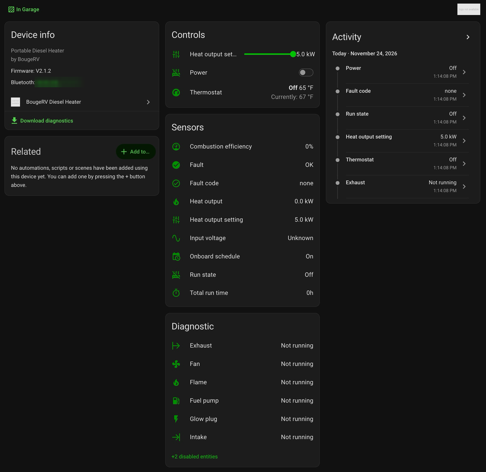
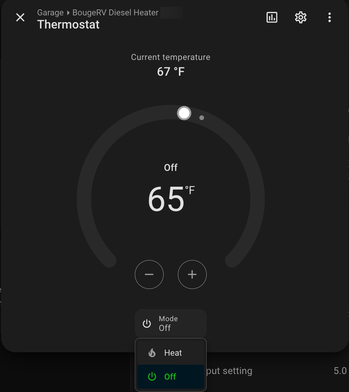
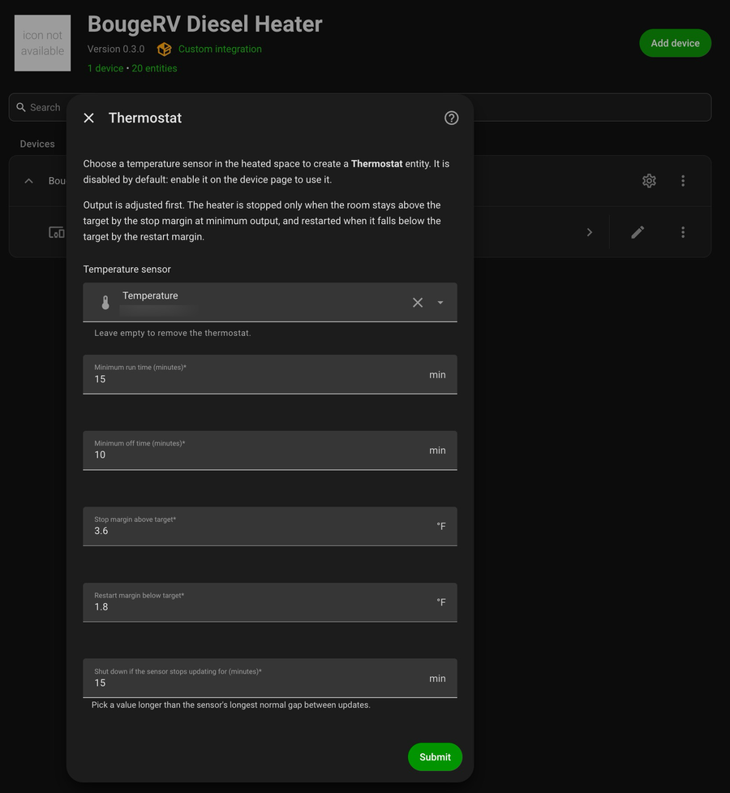

# BougeRV Diesel Heater — Home Assistant HACS Integration

Local Bluetooth monitoring and control for BougeRV portable diesel heaters (standard model) in Home Assistant, with no cloud account.

> **Disclaimer:** This is an unofficial community integration. It is not affiliated with, endorsed by, or supported by BougeRV. Use it at your own risk.

## What it does

- **Monitoring:** run state, heat output, voltage, efficiency, run time, component activity, and faults with possible causes and recovery steps.
- **Controls:** power on/off and heat output, with the same safety rules as the BougeRV app.
- **Thermostat:** holds a target temperature using any Home Assistant temperature sensor, adjusting heat output before resorting to stopping and restarting.

Everything that can start or change the heater is **disabled by default**. Out of the box the integration only reports what the heater is doing.

## Features / Entities

### Monitoring

| Entity | Type | Notes |
|---|---|---|
| Run state | Sensor | Off, Starting, Running, Shutting down |
| Heat output | Sensor (kW) | Actual output |
| Heat output setting | Sensor (kW) | The selected output, 1.4–5.0 kW |
| Combustion efficiency | Sensor (%) | 0–99%, matching the BougeRV app. It sits at 99% for most of a normal run |
| Input voltage | Sensor (V) | Unknown while the heater is off, because the heater only measures it while running |
| Total run time | Sensor (h) | Lifetime whole hours |
| Fault | Binary sensor (problem) | On while the heater reports a fault |
| Fault code | Sensor | `none`, or the code the app shows (E0–E12, C4, C7/CONN), with the fault name, possible causes, and recovery steps as attributes |
| Onboard schedule | Binary sensor | On when the heater's built-in daily timer is enabled, with the selected hours as the app labels them |
| Fan, Fuel pump, Glow plug, Flame, Intake, Exhaust | Binary sensors (diagnostic) | Component activity |
| Signal strength | Sensor (diagnostic, disabled by default) | Bluetooth RSSI |
| Status frame | Sensor (diagnostic, disabled by default) | Raw status bytes, for troubleshooting |

### Controls (all disabled by default)

| Entity | Type | Notes |
|---|---|---|
| Power | Switch | On while starting or running. Turning it off starts the normal shutdown and cool-down |
| Heat output setting | Number | 1.4–5.0 kW in 0.1 kW steps, changeable while the heater is starting or running. It shows the same value as the Heat output setting sensor, but can change it |
| Thermostat | Climate | Off / Heat with a target temperature. Created once a temperature sensor is chosen in the options (see [Thermostat](#thermostat)) |

To use a control, open **Settings → Devices & services → BougeRV Diesel Heater**, select the heater's device, open the disabled entities, and enable the ones you want.

The heater sends status about once a second over a held-open Bluetooth connection. If status stops arriving, every entity becomes **unavailable** rather than showing stale values. A heater that has lost its connection may still be running.

## Requirements

- Home Assistant 2025.2 or newer with Bluetooth set up, using a local adapter, an ESPHome Bluetooth proxy, or both.
- A BougeRV standard diesel heater that advertises as `BougeRV-DHG001`–`DHG004` or `LFB00000`. The Diesel Heater Pro (`BougeRV-DHG005`, `BougeRV-DHG10`) is **not** supported.

The heater accepts more than one Bluetooth connection at a time, so the BougeRV phone app keeps working alongside Home Assistant.

## Installation (HACS)

1. In HACS, open the menu and choose **Custom repositories**.
2. Add `https://github.com/phurth/ha-bougerv-heater` with type **Integration**.
3. Install **BougeRV Diesel Heater**, then restart Home Assistant.

## Configuration

Home Assistant discovers heaters in Bluetooth range automatically. You can also add one from **Settings → Devices & services → Add integration → BougeRV Diesel Heater**.

**Confirm the MAC address before adding a heater.** The heater has no Bluetooth pairing or password, so any BougeRV heater in range can be added, including a neighbor's. Setup shows the heater's MAC address and will not finish until you confirm it:

1. In the BougeRV app (Android or iOS), open the heater and tap the settings (gear) icon.
2. Check that the MAC address shown there matches the one in Home Assistant.

If you can't find the MAC address in the app, unplug your heater for a minute and start discovery again. Your heater will not be listed while it is unplugged.

The integration's **Configure** button holds the thermostat settings. Nothing else needs configuring.

## Controls and safety

The controls follow the same rules as the BougeRV app, and Home Assistant refuses a command with an explanation when it isn't allowed:

- **Power on** only from Off with no active fault. It is refused during the cool-down.
- **Power off** while running, or while the heater is on with an active fault. It is refused during a normal startup, as in the app, and is unnecessary during the cool-down.
- **Heat output** only while starting or running with no active fault.

Every command is sent once, and the integration then waits for the heater's status to confirm it. If the heater doesn't confirm within a few seconds, Home Assistant shows an error rather than assuming the command worked.

Expect about **4½ minutes** from power on to Running, and about **4½ minutes** of cool-down after power off. During startup the heater follows its own output ramp, then moves to the setting once running. Reaching full output from cold can take 10 minutes or more.

Remote starting a combustion heater carries real risk. Before automating the power switch or using the thermostat:

- Keep a working carbon monoxide alarm near the heater.
- Never cut the heater's battery power until it shows Off after the cool-down. Removing power early can damage the heater.
- If the Bluetooth link drops while the heater is running, Home Assistant can't turn it off. The heater keeps running until it's stopped from the app or its own controls.

## Thermostat

1. Open **Settings → Devices & services → BougeRV Diesel Heater → Configure** and choose a temperature sensor in the space being heated.
2. Enable the **Thermostat** entity on the heater's device page.
3. Set it to **Heat** with a target temperature.

**How it heats.** The thermostat adjusts heat output first: 5.0 kW when the room is well below target, easing to 1.4 kW as it reaches the target, changing at most once a minute. It stops the heater only when the room stays above the target by the stop margin at 1.4 kW for **3 minutes**, so a brief spike from a jumpy sensor doesn't cause a stop. It restarts once the room falls below the target by the restart margin.

| Option | Default | Notes |
|---|---|---|
| Temperature sensor | — | Required. Remove it to remove the thermostat |
| Minimum run time | 15 minutes | The heater won't be stopped for being warm before this |
| Minimum off time | 10 minutes | The heater won't be restarted before this |
| Stop margin | 2 °C (3.6 °F) | Above the target |
| Restart margin | 1 °C (1.8 °F) | Below the target |
| Sensor timeout | 15 minutes | Choose a value longer than the sensor's longest normal gap between updates |

Margins are shown in your Home Assistant temperature unit.

**Safety behavior:**

- **Turning the thermostat Off** shuts the heater down normally, including the cool-down.
- **Stopping the heater from the app or its panel** switches the thermostat to Off, so it won't restart a heater someone stopped on purpose.
- **If the temperature sensor stops reporting** for the sensor timeout, a running heater is shut down.
- **A heater fault, or a start the heater doesn't confirm,** locks the thermostat out. Set it to Off, then back to Heat, once the cause is fixed.
- **The heater's onboard schedule** can start the heater even while the thermostat is off. If the schedule is on with hours selected, Home Assistant shows a repair notice. Clear the hours in the BougeRV app if you use the thermostat.
- The thermostat runs in Home Assistant. If Home Assistant or the Bluetooth link fails while the heater is running, the heater keeps running at its last output.

The thermostat's **Control** attribute says what it is doing and why, for example `regulating`, `waiting for the minimum off time`, or `holding minimum output before stopping`. The **Lockout** attribute shows why it is locked out, if it is.

## Notes & Limitations

- **No authentication.** The heater's Bluetooth protocol has no pairing or password. Any Bluetooth device in range can talk to it. This integration cannot change that.
- **Onboard schedule.** The heater can start itself from its built-in timer without any app or Home Assistant connection. The Onboard schedule entity shows whether that timer is enabled and which hours are set. Editing the schedule is not supported: use automations or the thermostat instead.
- **Signal strength.** At around −80 dBm or weaker the connection may drop occasionally. The integration reconnects within seconds and uses whichever adapter or proxy can reach the heater, so a Bluetooth proxy near the heater gives the most reliable results.
- **Not supported:** the Diesel Heater Pro, and editing the onboard schedule.

## Troubleshooting

- **Entities unavailable:** the heater is out of range, unplugged, or not sending status. Check its signal strength (enable the Signal strength entity) and consider a Bluetooth proxy closer to the heater.
- **A control refuses a command:** the error message gives the reason, such as an active fault, the heater still starting, or the cool-down in progress.
- **Reporting an issue:** download diagnostics from the heater's device page and attach them. The heater's address is removed. Enabling the **Status frame** entity beforehand records the raw status in history, which helps with anything protocol-related.

Protocol details are in [docs/TECH_SPEC.md](docs/TECH_SPEC.md).

## License

MIT
